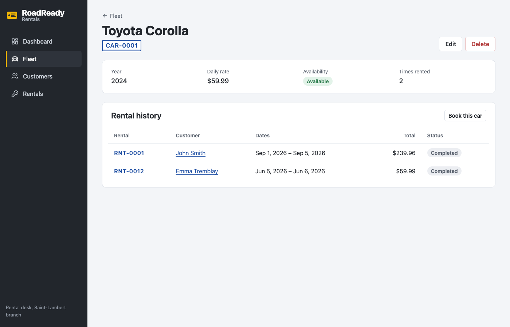
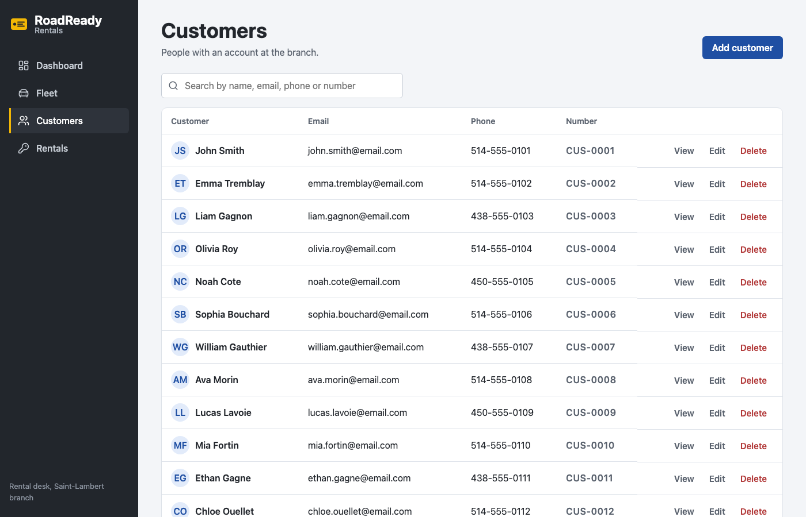
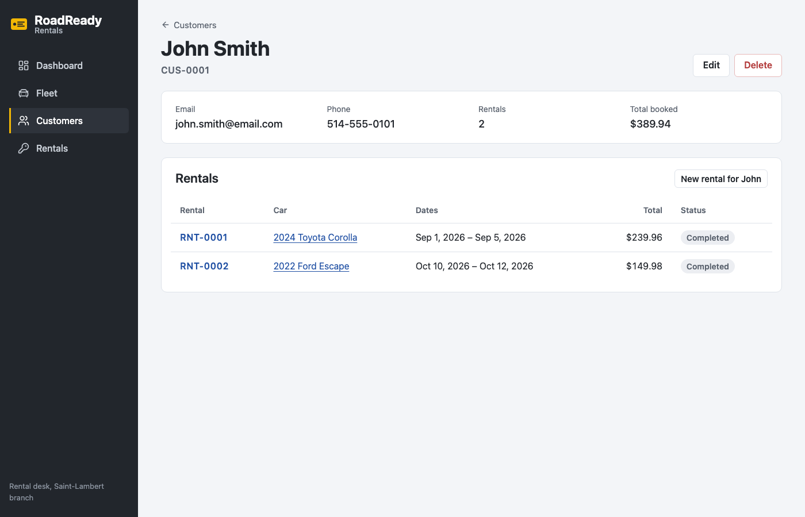
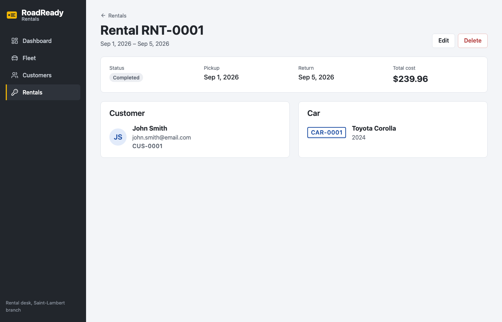
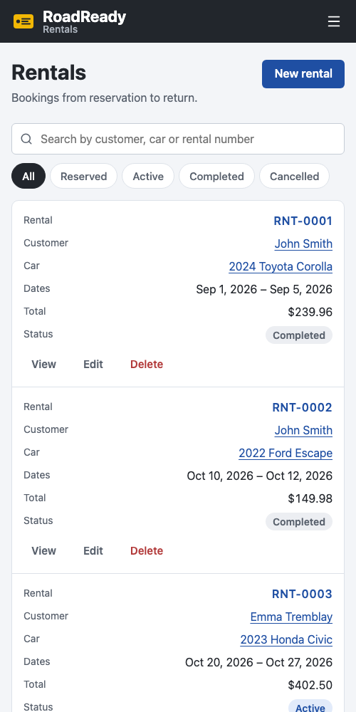

# RoadReady Rentals (Frontend)

React + TypeScript frontend for the **Car Rental API** built in Milestone 2.
Rental desk staff can manage the **fleet (cars)**, **customers** and **rentals**, see what's on the lot,
and follow the links between a customer, their rentals and the cars they rented.

All data comes from the deployed Spring Boot backend. There is no hardcoded or local sample data.

- **Backend API base URL:** `https://car-rental-project-k0e4.onrender.com`
- **Swagger UI:** https://car-rental-project-k0e4.onrender.com/swagger-ui.html
- **Frontend deployment URL:** _add the URL here after deploying (see below)_

> The backend runs on Render's free plan, which sleeps after a while with no traffic.
> The first request can take up to a minute. The app shows a loading message while it waits.

## Technologies

| What | Used for |
| --- | --- |
| React 19 + TypeScript | UI with functional components and hooks (`useState`, `useEffect`, `useContext`) |
| Vite | Dev server and build |
| React Router | Navigation between pages |
| Axios | HTTP calls to the REST API |
| lucide-react | A few icons (menu, search, back link) |
| Plain CSS | Styling and responsive layout (`src/index.css`) |
| Barlow / Barlow Condensed (Google Fonts) | Typography |

## Run it locally

Requirements: Node.js 20 or newer.

```bash
npm install
cp .env.example .env     # then edit the URL if needed
npm run dev
```

Open http://localhost:5173.

Other scripts:

```bash
npm run build     # type-check + production build into dist/
npm run preview   # serve the production build
npm run lint      # oxlint
```

## Environment variables

| Variable | Description | Example |
| --- | --- | --- |
| `VITE_API_BASE_URL` | Base URL of the Spring Boot API, no trailing slash | `https://car-rental-project-k0e4.onrender.com` |

To use the backend running on your machine instead, set `VITE_API_BASE_URL=http://localhost:8080` in `.env`
and restart `npm run dev`. The backend already allows CORS requests from any origin (`WebConfig`).

## Project structure

```
src/
├── components/     reusable UI pieces (PageHeader, SearchBar, FilterChips, ConfirmDialog,
│                   RentalsTable, StatusBadge, Loader, ErrorMessage, EmptyState, ToastContext...)
├── layouts/        MainLayout (sidebar + page content)
├── pages/
│   ├── DashboardPage.tsx
│   ├── NotFoundPage.tsx
│   ├── cars/       CarListPage, CarDetailsPage, CarFormPage
│   ├── customers/  CustomerListPage, CustomerDetailsPage, CustomerFormPage
│   └── rentals/    RentalListPage, RentalDetailsPage, RentalFormPage
├── routes/         AppRoutes (all the routes of the app)
├── services/       api.ts (axios + error helpers), carService, customerService, rentalService
├── types/          TypeScript interfaces matching the backend DTOs
├── utils/          formatting helpers (money, dates, names)
├── App.tsx
├── main.tsx
└── index.css
```

Pages never call axios directly. They call the functions in `src/services`, which return typed data.

## Pages and routes

| Route | Page |
| --- | --- |
| `/` | Dashboard: the lot (every car coloured by availability), totals, booked revenue, rentals by status, next pickups |
| `/cars`, `/customers`, `/rentals` | Lists with search, View / Edit / Delete and an "Add" button |
| `/cars/:carId` | Car details + its rental history (`GET /api/cars/{carId}/rentals`) |
| `/customers/:customerId` | Customer details + their rentals (`GET /api/customers/{customerId}/rentals`) |
| `/rentals/:rentalId` | Rental details + links to its customer and car (`GET /api/rentals/{rentalId}/details`) |
| `/cars/new`, `/cars/:carId/edit` (same for customers and rentals) | Create / update forms |

### Search and filters

- **Fleet:** search by make, model, year or plate. Filter by availability (uses `GET /api/cars?status=`).
- **Customers:** search by name, email, phone or customer number.
- **Rentals:** search by customer, car or rental number. Filter by status (uses `GET /api/rentals?status=`).
- Every list has a "Clear filters" / "Clear search" button.

### Relationships

- Customer → Rental (one-to-many): a customer page lists their rentals. A rental page links back to the customer.
- Car → Rental (one-to-many): a car page lists its rentals. A rental page links back to the car.
- The rental form uses dropdowns to choose the customer and the car. "New rental for …" on a customer page
  and "Book this car" on a car page open the form with that customer or car already selected.

### Validation and errors

- Forms check the same rules as the backend DTOs before sending (required fields, lengths, year range,
  rate above 0, email format, return date not before pickup date).
- Errors from the backend are shown too: field errors (400), duplicate email (409),
  car already booked or in maintenance (409 / 400), record not found (404).
- Every page has a loading state, an empty state and an error state with a "Try again" button.
- Deleting asks for confirmation first. A message confirms every create, update and delete.

## Deploying

The app is a static site after `npm run build` (output in `dist/`).

**Render (Static Site):**
1. New → Static Site → connect this repository.
2. Build command: `npm install && npm run build`. Publish directory: `dist`.
3. Environment variable: `VITE_API_BASE_URL=https://car-rental-project-k0e4.onrender.com`.
4. Redirects/Rewrites: add a rewrite from `/*` to `/index.html`, so that refreshing a page like `/cars/CAR-0001` works.

**Vercel / Netlify** work the same way: build `npm run build`, output `dist`, and set the same environment variable.

## Screenshots

| Dashboard | Fleet |
| --- | --- |
|  |  |

| Car details | Customers |
| --- | --- |
|  |  |

| Customer details | Rental details |
| --- | --- |
|  |  |

| New rental form | Mobile |
| --- | --- |
|  |  |
