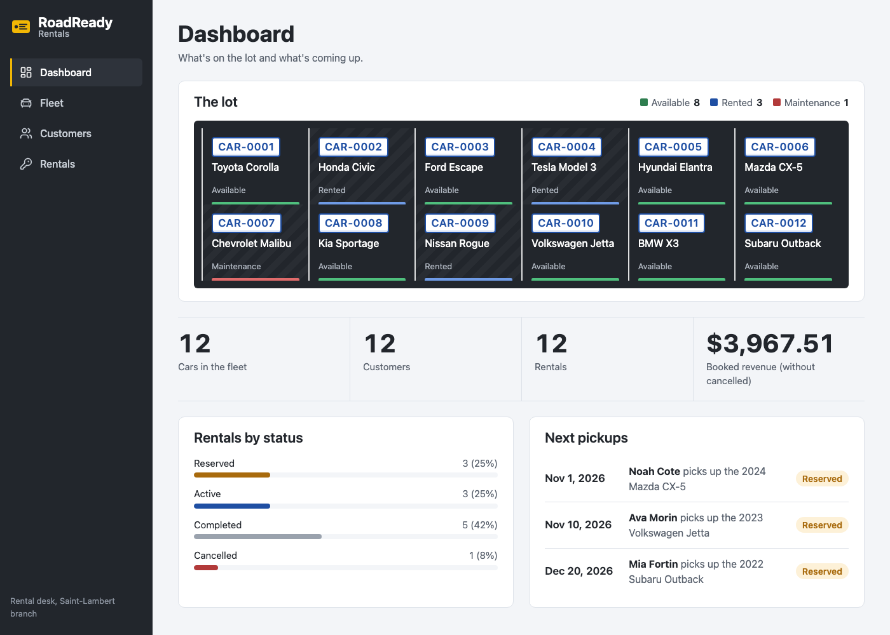
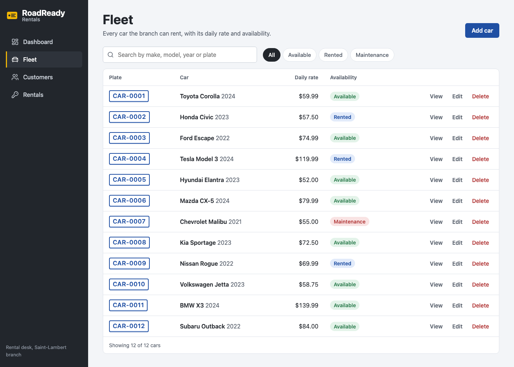
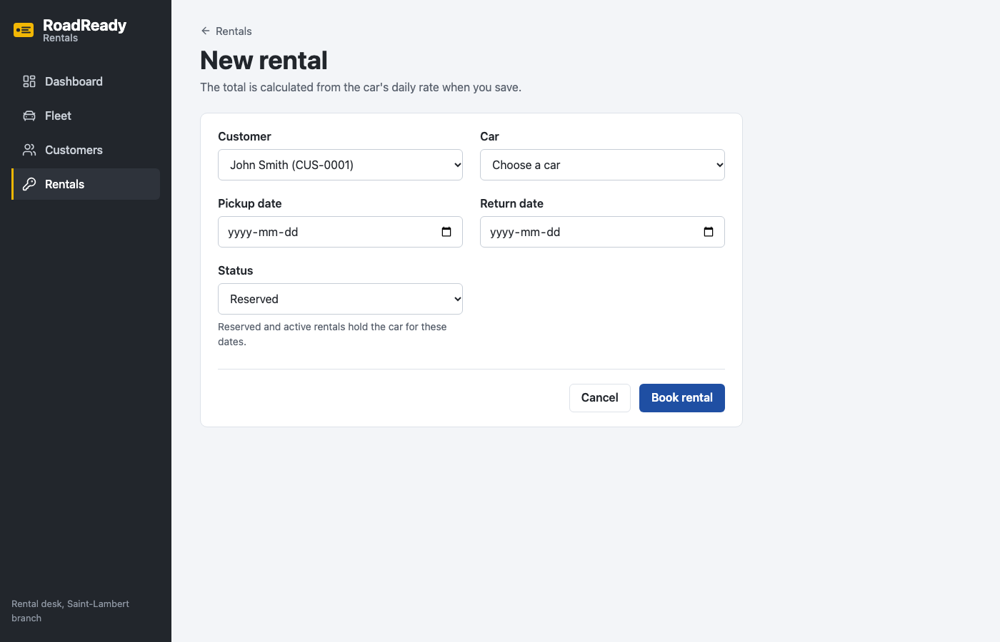

# Car Rental Frontend

React + TypeScript frontend for the Car Rental API (Milestone 2).
It lets you manage cars, customers and rentals, and navigate between them.

- **Backend API:** https://car-rental-project-k0e4.onrender.com
- **Frontend:** _add the Render URL here_

Note: the backend is on Render's free plan, so the first request can take up to a minute.

## Technologies

- React 19 + TypeScript
- Vite
- React Router
- Axios
- lucide-react (icons)
- CSS

## Run locally

```bash
npm install
npm run dev
```

Then open http://localhost:5173.

## Environment variables

The backend URL is set in `.env`:

```
VITE_API_BASE_URL=https://car-rental-project-k0e4.onrender.com
```

To use a local backend, change it to `http://localhost:8080` and restart `npm run dev`.

## Project structure

```
src/
├── components/   reusable components
├── layouts/      main layout with the sidebar
├── pages/        dashboard + cars, customers and rentals pages
├── routes/       app routes
├── services/     API calls (axios)
├── types/        TypeScript interfaces for the DTOs
├── utils/        formatting functions
├── App.tsx
└── main.tsx
```

## Deployment

Deployed on Render as a static site using `render.yaml`
(build: `npm install && npm run build`, publish folder: `dist`).

## Screenshots

Dashboard


Cars


Car details


Customers


Customer details


Rental details


New rental

